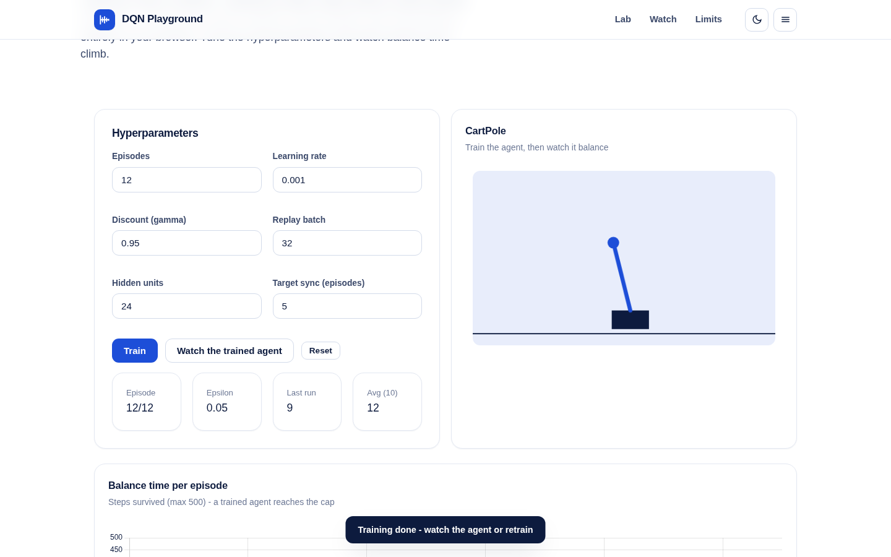
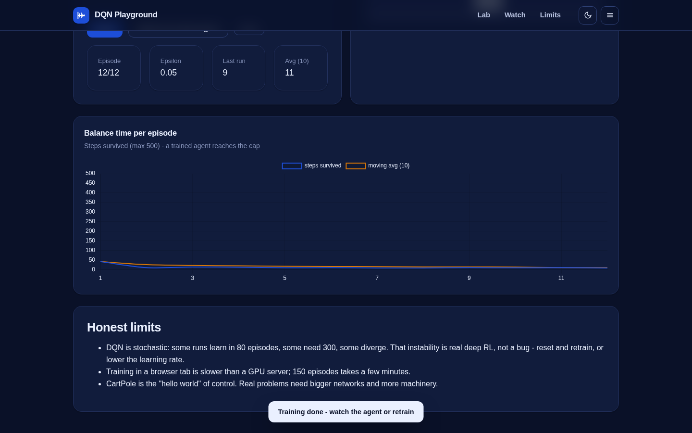
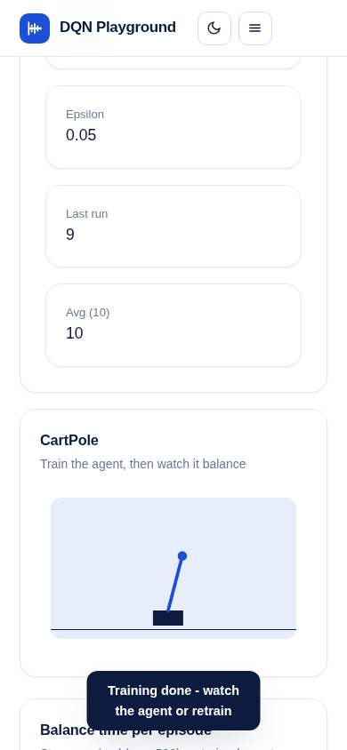

# DQN Playground

A real Deep Q-Network learning CartPole in your browser - experience replay, target network, epsilon decay, live training curves.

Tune learning rate, discount, replay batch, hidden units and target-sync cadence, hit Train, and watch the balance-time curve climb from ~20 steps to hundreds. Then watch the trained policy balance the pole live on the canvas.

**Live demo:** https://akash991833.github.io/dqn-playground/



## Features

- Genuine DQN: online + target networks, replay buffer (10k), epsilon-greedy with decay
- Full CartPole physics (gym-style dynamics, 500-step cap)
- Tunable hyperparameters: episodes, learning rate, gamma, batch size, hidden units, target sync
- Live Chart.js curve of steps survived per episode with moving average
- Animated cart-pole rendering of the trained greedy policy
- TensorFlow.js vendored locally - trains fully offline, no CDN, no keys

## Honest limits

- DQN is stochastic: some runs learn in 80 episodes, some need 300, some diverge. That instability is real deep RL - reset and retrain, or lower the learning rate.
- Browser-tab training is slower than a GPU server; 150 episodes takes a few minutes.
- CartPole is the hello world of control; real problems need bigger machinery.

## Tech

Vanilla JS + TensorFlow.js + Chart.js (all vendored). Classic CartPole equations of motion, normalized 4-D state, Adam, MSE loss on Q-targets.

## Run locally

```
python3 -m http.server 8068
# open http://localhost:8068
```

## Tests

```
python3 -m http.server 8068 &
node tests/run.mjs desktop-light   # heavy ML check (80 episodes, ~1 min)
node tests/run.mjs desktop-dark    # UI/visual checks per combo
node tests/run.mjs mobile-light
node tests/run.mjs mobile-dark
```

Desktop-light runs the full ML assertion (training improves balance time, trained agent beats random play); every combo checks env physics, UI training completion, canvas rendering, KPIs and console cleanliness.



